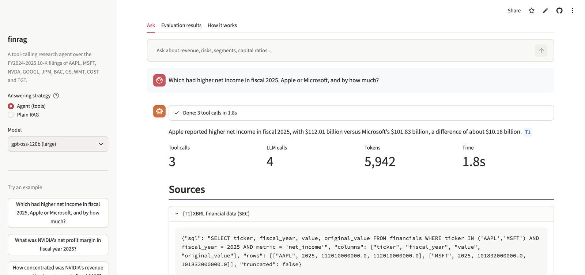
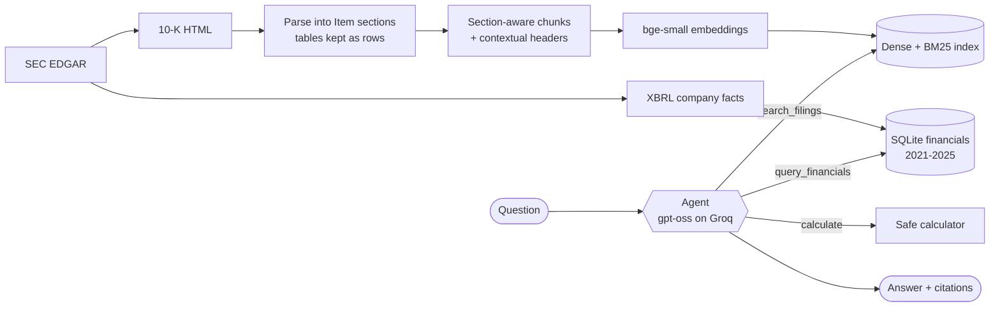
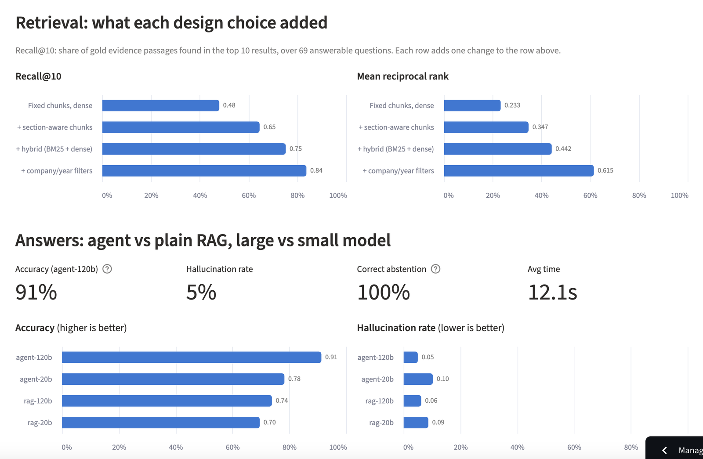

# finrag: a tool-calling research agent over SEC 10-K filings

[](https://github.com/kbansal18/finrag-agent/actions/workflows/ci.yml)
**Live demo: [finrag-agent-krishiv.streamlit.app](https://finrag-agent-krishiv.streamlit.app)**

Ask questions about the FY2024–2025 10-K filings of ten S&P 500 companies (AAPL, MSFT,
NVDA, GOOGL, JPM, BAC, GS, WMT, COST, TGT). An LLM agent plans its own research: it
searches the filings with company/year filters, queries standardized SEC financial data
with SQL, and does arithmetic with a calculator. Every claim cites its source.

The point of the project is the **evaluation**: an 80-question test set with
source-verified gold answers, measuring retrieval quality, answer accuracy, and
hallucination across configurations.



## Results at a glance

- **Agent vs plain RAG (same model, gpt-oss-120b): 91.3% vs 73.9% accuracy** on 80
  questions. Paired test: the agent was right where RAG was wrong 18 times, the reverse 6
  times (exact McNemar p = 0.023).
- **The gain is all on multi-step questions.** On single-filing lookups the two tie
  (35 vs 37 of 40). On calculations, cross-company comparisons and multi-year questions
  the agent gets **28/29 vs 14/29**.
- **Tools only pay off with a capable model.** The 120b agent beats the 20b agent on 9
  questions and loses none (p = 0.004), while the 20b agent's edge over plain RAG
  (78.3% vs 69.6%) is not statistically distinguishable from noise (p = 0.39).
- **Low hallucination, safe failures**: 5% of agent answers contain a claim not supported
  by their citations; all 11 unanswerable questions are correctly declined. RAG's misses
  are mostly "not available" refusals (25% over-abstention), not invented numbers.
- **Retrieval design compounds**: section-aware chunking, hybrid search and metadata
  filters take recall@10 from 0.48 to 0.84 and MRR from 0.23 to 0.62.

## How it works



| Stage | What it does | Code |
|---|---|---|
| Ingest | Downloads 20 10-Ks from EDGAR (rate-limited, retried, idempotent) and 15 XBRL metrics for 2021–2025 into SQLite | `ingest/edgar.py`, `ingest/xbrl.py` |
| Parse | HTML to text with block-aware extraction; tables rendered row by row; finds the real Item headings past tables of contents, page headers and cross-references | `ingest/parse.py` |
| Chunk | Never crosses an Item; splits tables between rows and repeats their column headers; prepends `Company (TICKER) \| FY2025 10-K \| Item 7: MD&A \| subsection` | `retrieval/chunking.py` |
| Retrieve | bge-small-en-v1.5 (ONNX via fastembed) + BM25, fused with Reciprocal Rank Fusion; filters applied before ranking | `retrieval/retriever.py` |
| Agent | Tool-calling loop (max 6 steps) with three tools; read-only SQL; AST-based calculator; loop guard against repeated searches | `agent/` |
| App | Streamlit: live tool trace, cited sources linked to SEC.gov, evaluation dashboard | `streamlit_app.py` |

## Evaluation

### The question set ([`eval/questions.yaml`](eval/questions.yaml))

| Category | n | Tests |
|---|---|---|
| fact | 22 | Finding a stated fact (headcount, segments, growth drivers) |
| numeric_lookup | 18 | Reading the right number from a financial table |
| numeric_calc | 12 | Retrieving 2+ figures and computing (margins, growth) |
| comparison | 10 | Combining 2–4 companies' filings |
| structured | 7 | Data only in the XBRL table (FY2021, 5-year trends) |
| unanswerable | 11 | Not in the corpus; the correct response is to decline |

Gold evidence is stored as **verbatim quotes from the filing, not chunk IDs**, so the same
set scores any chunking strategy. `make eval-check` verifies every quote exists in its
filing and every numeric answer matches the XBRL table. Several questions are deliberate
traps: Bank of America's restated 2024 revenue, NVIDIA's pre-split EPS, Target's
fiscal-year naming, and banks having no gross margin.

### Retrieval (`make eval-retrieval`, no LLM)

Each row adds one change to the row above. Recall@10 = share of gold evidence passages in
the top 10; MRR = mean reciprocal rank of the first hit.

| Configuration | Recall@1 | Recall@10 | MRR |
|---|---|---|---|
| Fixed 384-token chunks, dense | 0.12 | 0.48 | 0.233 |
| + section-aware chunks | 0.21 | 0.65 | 0.347 |
| + hybrid (BM25 + dense, RRF) | 0.31 | 0.75 | 0.442 |
| + company/year filters | **0.52** | **0.84** | **0.615** |

On comparison questions, filters did **not** help (0.62 → 0.59): one query cannot fill 10
slots with good passages from four filings. That finding drove the agent design: search
once per company.

### Answers (`make eval-answers`)

| Config | Accuracy | Numeric acc. | Correct abstention | Over-abstention | Hallucination | Citations | Tokens/q |
|---|---|---|---|---|---|---|---|
| **agent-120b** | **91.3%** | **92.6%** | 100% | 0% | **5.0%** | 100% | 5,001 |
| agent-20b | 78.3% | 77.8% | 100% | 1.4% | 11.3% | 91.2% | 6,144 |
| rag-120b | 73.9% | 68.5% | 100% | 24.6% | 6.2% | 98.1% | 3,150 |
| rag-20b | 69.6% | 64.8% | 100% | 26.1% | 7.5% | 100% | 3,207 |

All four configurations were run on all 80 questions. Paired significance (exact McNemar,
counting questions one system got right and the other wrong):

| Comparison | Wins each way | p |
|---|---|---|
| agent-120b vs rag-120b | 18 vs 6 | **0.023** |
| agent-120b vs agent-20b | 9 vs 0 | **0.004** |
| agent-20b vs rag-20b | 20 vs 14 | 0.39 |
| agent-20b vs rag-120b | 17 vs 14 | 0.72 |

Agent vs RAG by category (gpt-oss-120b):

| Category | Agent | RAG |
|---|---|---|
| fact | 19/22 | 20/22 |
| numeric_lookup | 16/18 | 17/18 |
| numeric_calc | **12/12** | 8/12 |
| comparison | **9/10** | 4/10 |
| structured | **7/7** | 2/7 |
| unanswerable | 11/11 | 11/11 |

**How grading works.** An LLM judge from a different model family (Qwen 3.8 judging
gpt-oss, to limit self-preference bias) scores correctness, abstention, and claims not
supported by the cited sources. Independently, a deterministic check extracts numbers
from the answer and compares them with the gold value. **The two agree on 96–98% of
numeric questions.** Latency figures include waiting on free-tier rate limits.

**Human audit.** I hand-labelled a random sample of 25 graded answers, blind to the
judge's verdicts (`finrag-eval-answers --stage audit`, then `--stage agreement`):

| Judge verdict | Agreement with my labels | Cohen's kappa |
|---|---|---|
| Correct | 96% (24/25) | 0.78 |
| Contains unsupported claims | 96% (24/25) | 0.65 |

The two disagreements are borderline calls: the judge accepted "about 2%" for a 2.43%
decline (the filing's own rounded figure, but outside the question's tolerance), and it
flagged an uncited mention of a proxy statement that I did not count. A first pass of the
audit sheet truncated sources to 400 characters, which made supported claims look
unsupported; four labels were re-checked against the full cited text, and the sheet now
always shows full sources.



## Design decisions and lessons

- **Measure before building.** The retrieval eval showed single queries fail on
  comparisons; the agent's "search each company separately" behaviour came from that
  number, not from intuition.
- **Tables are where financial RAG breaks.** One-cell rows ended tables early, multi-row
  headers were lost when tables split, and footnote cells like `(b)` shifted every value a
  column. Each was found by reading retrieved chunks, and each has a test.
- **Exact numbers from structured data.** XBRL facts answer "what was revenue?" exactly;
  the text answers "why?". Pitfalls handled: companies tag the same concept differently,
  10-Ks repeat prior years (key on period end date, not `fy`), and restatements and stock
  splits change old figures (both the latest and as-reported values are stored).
- **Agents loop on unanswerable questions.** gpt-oss rephrased "iPhone units sold" eight
  times. A guard in the tool layer (refuse repeated searches, report when a search finds
  nothing new) cut that question from 35,511 tokens and 104 s to 7,718 tokens and 2 s.
- **Validate the metric, not just the model.** Early hallucination rates were inflated:
  gpt-oss cites as `[ S1 ]` and `[S2†L13-L16]`, which my parser missed, so correctly cited
  answers looked unsupported. The fix re-parsed stored answers and rebuilt their sources
  by replaying the recorded tool calls, with no new LLM calls.
- **Treat model output as untrusted input.** SQL runs on a read-only connection, SELECT
  only, single statement, row cap and timeout; the calculator is an AST walker, never
  `eval`. Tests attempt `DROP`, `ATTACH` and `__import__`.
- **No vector database.** About 8,000 vectors x 384 dims is 12 MB; exact search is one
  matrix product (about 1 ms). An ANN index would add a dependency and recall loss for no
  gain at this scale.

## Limitations

- 80 questions, written by one person; confidence intervals are wide (e.g. 91.3% on 80
  questions is roughly ±6 points).
- Numbers in table rows with blank cells can still misalign with their column headers;
  the XBRL tool covers the most common metrics.
- The judge was validated on 25 hand-labelled answers; a larger audit would narrow the
  uncertainty on agreement, especially for hallucination, where positives are rare.
- The free Groq tier limits tokens per day, so the public demo may occasionally be rate
  limited.

## Run it yourself

```bash
git clone https://github.com/kbansal18/finrag-agent && cd finrag-agent
python -m venv .venv && source .venv/bin/activate
make install
cp .env.example .env      # add GROQ_API_KEY and SEC_USER_AGENT ("Name email")
make data                 # download, parse, build XBRL table, embed (~25 min, one time)
make test                 # 88 tests
make app                  # Streamlit on localhost:8501
```

| Command | What it does |
|---|---|
| `finrag-ask "question" [--mode rag] [--model openai/gpt-oss-20b]` | Ask from the terminal, with the tool trace |
| `finrag-search "query" --tickers JPM --years 2025` | Inspect retrieval directly |
| `make eval-check` | Verify the question set against the sources |
| `make eval-retrieval` | Retrieval metrics for all indexes and modes (free, about 1 min) |
| `finrag-eval-answers` | Generate, grade and report answers (resumable; respects daily quotas) |
| `finrag-package-data` | Bundle the index for deployment (see below) |

**Deployment.** The index is built locally and published as a GitHub Release asset. On
Streamlit Community Cloud the app downloads it once, verifies its SHA-256, and extracts
it safely. Secrets: `GROQ_API_KEY`, `DATA_BUNDLE_URL`, `DATA_BUNDLE_SHA256`.

## Project layout

```
src/finrag/
  ingest/     edgar.py (10-K download) · xbrl.py (financials table) · parse.py (sections)
  retrieval/  chunking.py · embeddings.py · retriever.py · index.py
  agent/      agent.py (loop, RAG baseline) · tools.py (search, SQL, calculator) · llm.py
  eval/       dataset.py · retrieval.py · grading.py · answers.py
  config.py · data_bundle.py · ui.py
eval/questions.yaml       80 questions with gold answers and evidence
results/                  retrieval and answer metrics, every answer and verdict
streamlit_app.py          the app
config/corpus.yaml        companies and years
```

**Stack:** Python, BeautifulSoup/lxml, fastembed (bge-small-en-v1.5, ONNX), rank-bm25,
NumPy, SQLite, OpenAI-compatible API (Groq: gpt-oss-120b / 20b, Qwen judge), Streamlit,
Altair, pydantic-settings, pytest, ruff, GitHub Actions.
